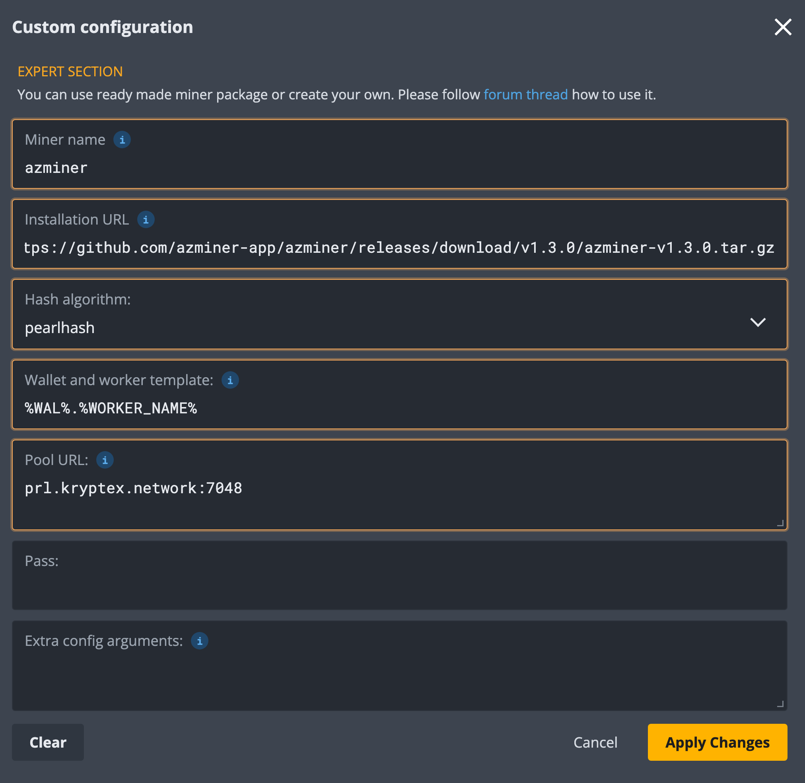
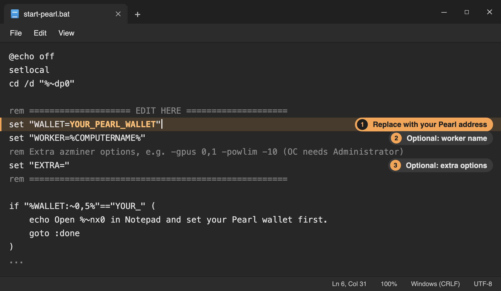

<div align="center">


# AZminer: Easy to Start, Built for Stability

[](https://github.com/azminer-app/azminer/releases/latest)
[](https://github.com/azminer-app/azminer/releases)
[](#license)
[![Website](https://img.shields.io/badge/website-azminer.app-F2A65A?logo=data:image/svg%2Bxml;base64,PHN2ZyB4bWxucz0iaHR0cDovL3d3dy53My5vcmcvMjAwMC9zdmciIHdpZHRoPSI1MTIiIGhlaWdodD0iNTEyIiB2aWV3Qm94PSItMSAtMSA2NiA2NiI%2BPGRlZnM%2BPGNsaXBQYXRoIGlkPSJrYiI%2BPHJlY3QgeD0iLTEwIiB5PSItMTAiIHdpZHRoPSI5MCIgaGVpZ2h0PSI2NiIvPjwvY2xpcFBhdGg%2BPGNsaXBQYXRoIGlkPSJrYyI%2BPHBhdGggZD0iTTEyIDU2IEwzNS40NiAtNCBMODAgLTQgTDgwIDU2WiIvPjwvY2xpcFBhdGg%2BPG1hc2sgaWQ9ImsiIG1hc2tVbml0cz0idXNlclNwYWNlT25Vc2UiIHg9Ii0xMCIgeT0iLTEwIiB3aWR0aD0iOTAiIGhlaWdodD0iOTAiPjxyZWN0IHg9Ii0xMCIgeT0iLTEwIiB3aWR0aD0iOTAiIGhlaWdodD0iOTAiIGZpbGw9IiNmZmYiLz48cGF0aCBkPSJNNSA2MC45IEw1MC44IDE1LjgiIHN0cm9rZT0iIzAwMCIgc3Ryb2tlLXdpZHRoPSIxMCIgY2xpcC1wYXRoPSJ1cmwoI2tjKSIvPjwvbWFzaz48L2RlZnM%2BPGcgdHJhbnNmb3JtPSJ0cmFuc2xhdGUoMCA0KSI%2BPHBhdGggZD0iTTUgNjAuOSBMNTAuOCAxNS44IiBmaWxsPSJub25lIiBzdHJva2U9IiNGRkZGRkYiIHN0cm9rZS13aWR0aD0iNiIgY2xpcC1wYXRoPSJ1cmwoI2tiKSIvPjxnIG1hc2s9InVybCgjaykiPjxwYXRoIGQ9Ik0yIDU2IEwyMCAxMCBMMzggNTYgSDI4IEwyMCAzNS42IEwxMiA1NloiIGZpbGw9IiNGRkZGRkYiLz48cGF0aCBkPSJNNDEgMzQgSDYzIFY0MC41IEw1MS41IDUwIEg2MyBWNTYgSDQxIFY1MCBMNTIuNSA0MC41IEg0MVoiIGZpbGw9IiNGRkZGRkYiLz48L2c%2BPHBhdGggZD0iTTUgNjAuOSBMNTAuOCAxNS44IiBmaWxsPSJub25lIiBzdHJva2U9IiNGRkZGRkYiIHN0cm9rZS13aWR0aD0iNiIgY2xpcC1wYXRoPSJ1cmwoI2tjKSIvPjxwYXRoIGQ9Ik0zOCA4LjMgUTU2LjIgMTEuMyA1NiAyOS43IFE0OC41IDE3LjcgMzggOC4zWiIgZmlsbD0iI0ZGRkZGRiIvPjwvZz48L3N2Zz4K)](https://azminer.app)
[](https://t.me/+DYOBpOCui9EzNDM1)
[](https://discord.gg/uzDmVnyups)
<br>
[](#highlights)
[](#windows)
[](#linux)
[](#hiveos)
[](#supported-coins--dev-fees)

</div>

AZminer is an NVIDIA GPU miner for Pearl, Quantus, Vearl and Parano1d. Paste your wallet and start mining in minutes on Windows, Linux or HiveOS. Pool failover, a watchdog and temperature protection keep it running day and night.

Download the latest build from [Releases](https://github.com/azminer-app/azminer/releases/latest) or [azminer.app](https://azminer.app).

## Table of contents

1. [Highlights](#highlights)
2. [Try it in one command](#try-it-in-one-command)
3. [Quick start](#quick-start): [HiveOS](#hiveos) · [Windows](#windows) · [Linux](#linux)
4. [Download](#download)
5. [Supported coins & dev fees](#supported-coins--dev-fees)
6. [Supported pools](#supported-pools): [Address format](#pool-address-format) · [Wallet and worker](#wallet-worker-and-password)
7. [Options](#options): [Basic](#basic-options) · [Choosing GPUs](#choosing-gpus) · [Backup pool](#backup-pool--failover) · [Config file](#config-file) · [Logs](#logs-and-screen-output) · [Every option](#every-option-azminer---help)
8. [Overclocking & temperature](#overclocking--temperature): [Clock locks](#core-clock-lock--memory-clock-lock) · [Offsets & power](#offsets-and-power-limit) · [Per-GPU values](#per-gpu-values) · [Fans & temperature](#fans--temperature-limits) · [Tuning step by step](#tuning-step-by-step) · [CMP cards](#nvidia-cmp-cards)
9. [Stability](#stability): [Watchdog](#watchdog) · [Mining schedule](#mining-schedule) · [Long-running rig](#a-rig-that-runs-for-weeks)
10. [Monitoring API](#monitoring-api): [Endpoints](#endpoints) · [Reading the miner screen](#reading-the-miner-screen)
11. [Troubleshooting](#troubleshooting)
12. [Support](#support)
13. [License](#license)

## Highlights

- **Four coins, one miner:** Pearl, Quantus, Vearl and Parano1d. Switch coin by changing `-a`.
- **Native NVIDIA:** built for RTX 20 to RTX 50 series (Turing to Blackwell), plus CMP cards on Linux.
- **Overclocking built in:** core clock lock, memory clock lock, offsets, power limit and fan control per GPU. No separate OC tool.
- **Keeps running:** backup pool failover, stall watchdog, temperature pause and resume, daily schedule.
- **HiveOS ready:** custom miner bundle with hashrate, temperature, fan and share stats on the dashboard.
- **Monitoring API:** per-GPU stats as JSON on `127.0.0.1:3333`.

## Try it in one command

Linux: copy one line, replace `YOUR_WALLET` with your address, run. On Windows, follow [Quick start · Windows](#windows); it takes three clicks.

<details open>
<summary><strong>Pearl (PRL)</strong></summary>

```bash
curl -fL -o azminer https://github.com/azminer-app/azminer/releases/download/v1.3.0/azminer-v1.3.0-linux-x86_64 && chmod +x azminer && \
./azminer -a pearl -o prl.kryptex.network:7048 -u YOUR_WALLET.rig1
```

</details>

<details>
<summary><strong>Quantus</strong></summary>

```bash
curl -fL -o azminer https://github.com/azminer-app/azminer/releases/download/v1.3.0/azminer-v1.3.0-linux-x86_64 && chmod +x azminer && \
./azminer -a quantus -o qtc.kryptex.network:7049 -u YOUR_WALLET.rig1
```

</details>

<details>
<summary><strong>Vearl</strong></summary>

```bash
curl -fL -o azminer https://github.com/azminer-app/azminer/releases/download/v1.3.0/azminer-v1.3.0-linux-x86_64 && chmod +x azminer && \
./azminer -a vearl -o pool.vearl.org:3333 -u YOUR_WALLET.rig1
```

</details>

<details>
<summary><strong>Parano1d</strong></summary>

```bash
curl -fL -o azminer https://github.com/azminer-app/azminer/releases/download/v1.3.0/azminer-v1.3.0-linux-x86_64 && chmod +x azminer && \
./azminer -a parano1d -o stratum+ssl://stratum.innovlab.cc:19601 -u YOUR_WALLET.rig1
```

</details>

**You are mining when the log shows accepted shares**, usually within two minutes. `rig1` is the worker name shown on the pool; use a different one per machine.

## Quick start

<details>
<summary><strong>New to mining? Four words you need</strong></summary>

- **Wallet:** the address that receives your coins. Create it in the coin's official wallet and paste it after `-u`. Never share the seed phrase; AZminer never asks for it.
- **Pool:** a server that combines many miners and pays each one for the work done. Each pool charges its own fee.
- **Hashrate:** how fast your GPU works. Higher means more coins. Units differ per coin, so compare within one coin only.
- **Accepted share:** work the pool has confirmed. Accepted shares in the log mean you are mining.

</details>

### HiveOS

Create a flight sheet: Coin **PRL**, your wallet, Pool **Configure in miner**, Miner **Custom**. Click **Setup Miner Config** and fill in:

| Field | Value |
| --- | --- |
| Miner name | `azminer` |
| Installation URL | `https://github.com/azminer-app/azminer/releases/download/v1.3.0/azminer-v1.3.0.tar.gz` |
| Hash algorithm | `pearlhash` (other coins: `quantus`, `vearl`, `parano1d`) |
| Wallet and worker template | `%WAL%.%WORKER_NAME%` |
| Pool URL | `prl.kryptex.network:7048` |
| Extra config arguments | leave empty to start; later add any [option](#options), e.g. `-lcc 1500 -lmc 810` |

<details>
<summary><strong>Show the HiveOS screen</strong></summary>



</details>

Apply the flight sheet. The HiveOS dashboard shows hashrate, temperature, fan and shares through the bundled stats script.

### Windows

Needs Windows 10 or 11 and an NVIDIA driver. Pick one of two ways.

**Option 1 · One click (easiest, nothing to edit)**

1. Open [azminer.app](https://azminer.app/#quick-start), pick **Pearl** and **Windows**.
2. Paste your Pearl wallet address and click **Download mine-pearl.bat**.
3. Double-click `mine-pearl.bat`.

The file downloads AZminer, checks its SHA-256, starts mining and restarts the miner if it ever stops. Your wallet never leaves your browser.

**Option 2 · ZIP package**

1. Download the [Windows ZIP](https://github.com/azminer-app/azminer/releases/download/v1.3.0/azminer-v1.3.0-windows-x86_64.zip) and extract it to a folder without spaces, such as `C:\azminer`.
2. Right-click `start-pearl.bat`, choose **Open with → Notepad**, and replace `YOUR_PEARL_WALLET` with your Pearl address. Save.
3. Double-click `start-pearl.bat`.

<details>
<summary><strong>Show the Notepad screen</strong></summary>



</details>

Only the three lines under `EDIT HERE` need changing:

| Line | What to put | Example |
| --- | --- | --- |
| `WALLET` | Your Pearl address (required) | `set "WALLET=YOUR_ADDRESS"` |
| `WORKER` | Name shown on the pool. Default: the PC name | `set "WORKER=rig1"` |
| `EXTRA` | Any [options](#options), space-separated | `set "EXTRA=-lcc 1500 -lmc 810"` |

Example: worker `rig1`, mining on GPU 0 to 3, each card with its own core lock and every card with memory at 810 MHz:

```bat
set "WALLET=YOUR_ADDRESS"
set "WORKER=rig1"
set "EXTRA=-g 0,1,2,3 -lcc 1500,1500,1450,1400 -lmc 810"
```

Clock, power and fan options need Administrator: right-click `start-pearl.bat` → **Run as administrator**. `start-pearl.bat` already mines on `prl.kryptex.network:7048` with `prl-eu.kryptex.network:7048` as backup pool. Other coins use `start-quantus.bat`, `start-vearl.bat` and `start-parano1d.bat` the same way.

### Linux

```bash
curl -fL -o azminer https://github.com/azminer-app/azminer/releases/download/v1.3.0/azminer-v1.3.0-linux-x86_64
chmod +x azminer
./azminer -a pearl -o prl.kryptex.network:7048 -u YOUR_WALLET.rig1
```

Needs an NVIDIA driver and GLIBC 2.28 or newer. Check which GPUs AZminer sees with `./azminer -list`.

## Download

Current version: **v1.3.0** · [all releases and changelogs](https://github.com/azminer-app/azminer/releases)

| Platform | File | Requirements |
| --- | --- | --- |
| **Windows x86_64** | [azminer-v1.3.0-windows-x86_64.zip](https://github.com/azminer-app/azminer/releases/download/v1.3.0/azminer-v1.3.0-windows-x86_64.zip) | Windows 10/11, NVIDIA driver |
| **Linux x86_64** | [azminer-v1.3.0-linux-x86_64](https://github.com/azminer-app/azminer/releases/download/v1.3.0/azminer-v1.3.0-linux-x86_64) | GLIBC 2.28+, NVIDIA driver |
| **HiveOS** | [azminer-v1.3.0.tar.gz](https://github.com/azminer-app/azminer/releases/download/v1.3.0/azminer-v1.3.0.tar.gz) | HiveOS custom miner bundle |

**New in v1.3.0:** core and memory clock locks (`-lcc`, `-lmc`), NVIDIA CMP card support on Linux and HiveOS, and a further small Pearl and Quantus hashrate gain.

<details>
<summary><strong>Verify a download (SHA-256)</strong></summary>

Download [SHA256SUMS](https://github.com/azminer-app/azminer/releases/download/v1.3.0/SHA256SUMS) from the same release and keep the original filenames.

```bash
# Linux
sha256sum --ignore-missing -c SHA256SUMS
```

```powershell
# Windows PowerShell
Get-FileHash .\azminer-v1.3.0-windows-x86_64.zip -Algorithm SHA256
```

Compare the hash with the line for that file in `SHA256SUMS`. Download AZminer only from this repository or azminer.app.

</details>

<details>
<summary><strong>Earlier releases</strong></summary>

- **v1.2.11:** Pearl and Quantus hashrate up 1–5% with better power efficiency.
- **v1.2.10:** gains on Volta, Ampere, Ada and Blackwell; AMD compatibility fixes on Windows; correct Vearl sigma reporting; miner-side figures that match the pool.

</details>

## Supported coins & dev fees

| Coin | Select with | HiveOS algorithm | Dev fee | Guide |
| --- | --- | --- | --- | --- |
| **Pearl (PRL)** | `-a pearl` | `pearlhash` | 2% | [azminer.app/pearl](https://azminer.app/pearl) |
| **Quantus** | `-a quantus` | `quantus` | 2% | [azminer.app/quantus](https://azminer.app/quantus) |
| **Vearl** | `-a vearl` | `vearl` | 2% | [azminer.app/vearl](https://azminer.app/vearl) |
| **Parano1d** | `-a parano1d` | `parano1d` | 2% | [azminer.app/parano1d](https://azminer.app/parano1d) |

The dev fee is mined in short, periodic intervals on the developer wallet, and every hashrate published here already includes it. Pool fees are separate and set by each pool.

## Supported pools

Any Stratum pool for the coin works. These are the pools AZminer ships with and tests against.

| Coin | Pool | Main address | Backup address | Notes |
| --- | --- | --- | --- | --- |
| **Pearl** | Kryptex | `prl.kryptex.network:7048` | `prl-eu.kryptex.network:7048` | Used by `start-pearl.bat`, with the backup already set |
| **Quantus** | Kryptex | `qtc.kryptex.network:7049` | `qtc-eu.kryptex.network:7049` | Used by `start-quantus.bat`, with the backup already set |
| **Vearl** | Vearl official | `pool.vearl.org:3333` | | 1% pool fee. Solo port `3366`. Addresses start with `vrl1` |
| **Parano1d** | Innovlab | `stratum+ssl://stratum.innovlab.cc:19601` | `stratum+ssl://hk2.innovlab.cc:19601` | TLS only. Addresses start with `o1` |

### Pool address format

```text
[scheme://]host:port
```

| Part | Value | Notes |
| --- | --- | --- |
| scheme | `stratum+tcp://` | Plain connection. Used when you leave the scheme out |
| | `stratum+ssl://` | TLS-encrypted connection. Required by TLS-only pools such as Parano1d |
| host | `prl.kryptex.network` | Pool hostname or IP address |
| port | `7048` | `1`–`65535`. Each pool lists its own ports |

### Wallet, worker and password

| Option | What to put | Example |
| --- | --- | --- |
| `-u` | Wallet address, then `.` and a worker name | `-u YOUR_WALLET.rig1` |
| `-worker` | Worker name as a separate option, if `-u` has only the wallet | `-u YOUR_WALLET -worker rig1` |
| `-p` | Pool password. Leave it out unless the pool asks for one (default `x`) | `-p x` |

Give each rig its own worker name so the pool shows them separately. On HiveOS the template `%WAL%.%WORKER_NAME%` fills in the rig name for you.

Mining on another pool that works well? Tell us in [Discord](https://discord.gg/uzDmVnyups) and we will add it to this table.

## Options

Every option works with one or two dashes: `-pool` and `--pool` are the same. Options go after the coin, pool and wallet, in any order.

```text
azminer -a <coin> -o <pool> -u <wallet>[.worker] [options]
```

### Basic options

| Option | Value | What it does | Example |
| --- | --- | --- | --- |
| `-a`, `-algo` | `pearl`, `quantus`, `vearl`, `parano1d` | Coin to mine. **Required.** `pearlhash` also works for Pearl and `qpow-poseidon2` for Quantus | `-a pearl` |
| `-o`, `-pool` | `[scheme://]host:port` | Main pool. **Required.** See [Pool address format](#pool-address-format) | `-o prl.kryptex.network:7048` |
| `-u`, `-wal` | `wallet` or `wallet.worker` | Your wallet, optionally with a worker name. **Required** | `-u YOUR_WALLET.rig1` |
| `-worker` | name | Worker name, when `-u` has only the wallet | `-worker rig1` |
| `-p`, `-pass` | text | Pool password. Default `x` | `-p x` |
| `-g`, `-gpus` | `all` or `0,1,…` | GPUs to mine on. Default `all` | `-g 0,2` |
| `-list` | | List detected GPUs and exit | `-list` |
| `--list-coins` | | List the coins in this build and exit | `--list-coins` |
| `-V`, `--version` | | Print the version and exit | `-V` |
| `-h`, `--help` | | Print the option list and exit | `--help` |

### Choosing GPUs

Run `-list` to see each GPU's index, then pass the ones you want to `-g`:

```bash
./azminer -a pearl -o prl.kryptex.network:7048 -u YOUR_WALLET.rig1 -g 0,2       # GPU 0 and GPU 2 only
./azminer -a pearl -o prl.kryptex.network:7048 -u YOUR_WALLET.rig1 -g 0,1,2,4   # 5-GPU rig, GPU 3 left out
./azminer -a pearl -o prl.kryptex.network:7048 -u YOUR_WALLET.rig1 -g all   # every GPU (default)
```

Rules: indices are whole numbers from `-list`, separated by commas, with no spaces, no empty entries and no duplicates.

### Backup pool & failover

Add a backup pool with `-pool2`. AZminer mines the main pool, and when it stops answering it reconnects, then moves to the backup on its own.

| Option | What it does |
| --- | --- |
| `-pool2 <url>` | Backup pool, same format as `-o` |
| `-wal2 <wallet>` | Wallet for the backup pool. Needs `-pool2` |
| `-pass2 <pass>` | Password for the backup pool. Needs `-pool2` |
| `-worker2 <name>` | Worker name for the backup pool. Needs `-pool2` |
| `-fret <n>` | Reconnect attempts on the main pool before failing over |
| `-ftimeout <sec>` | Reconnect when the pool sends no new job for this long |
| `-ptimeout <sec>` | Pool connection timeout |
| `-retrydelay <sec>` | Wait between reconnect attempts |

Pearl with the Kryptex EU server as backup:

```bash
./azminer -a pearl -o prl.kryptex.network:7048 -u YOUR_WALLET.rig1 \
  -pool2 prl-eu.kryptex.network:7048 -wal2 YOUR_WALLET.rig1
```

While reconnecting, the log shows `reconnecting in …s (attempt …)`, then `reconnected - authorized` once the pool accepts the login again.

### Config file

Put your settings in a JSON file and start AZminer with `-config`. Useful for rigs with many per-GPU values.

```bash
./azminer -config rig.json
./azminer -config rig.json -g 0     # command-line options win over the file
```

```json
{
  "algo": "pearl",
  "pool": "prl.kryptex.network:7048",
  "wal": "YOUR_WALLET",
  "worker": "rig1",
  "pool2": "prl-eu.kryptex.network:7048",
  "cclock-lock": [1500, 1500, 1450, 1450, 1400],
  "mclock-lock": [810, 810, 810, 405, 405],
  "tt": 65
}
```

Rules:

- The file is one JSON object. Keys are option names without the dashes.
- Values are plain values; per-GPU values are a list of numbers, in GPU order.
- An option on the command line overrides the same key in the file.
- Use one `-config` file at a time. Some options, such as `-config` itself, work only on the command line.

### Logs and screen output

| Option | What it does | Example |
| --- | --- | --- |
| `-logfile <path>` | Also write the log to this file | `-logfile azminer.log` |
| `-logdir <dir>` | Write log files into this folder | `-logdir logs` |
| `-logsmaxsize <size>` | Size cap for log files, so they never fill the disk | |
| `-log` | Turn file logging on | |
| `-quiet` | Less output | |
| `-nocolor` | No colour codes, for log collectors | |
| `-debug` | Extra diagnostic output, for bug reports | |
| `-gswin`, `-gsi` | Stats display settings | |

### Every option (`azminer --help`)

<details>
<summary><strong>Show the full <code>--help</code> output (v1.3.0)</strong></summary>

```text
USAGE:
  azminer -a <algo> -o <url> -u <wallet.worker> [-p <pass>] [options]

OPTIONS (both -long and --long are accepted):
  -a, -algo <pearlhash|quantus|parano1d|vearl> algorithm to mine
  -o, -pool <[scheme://]host:port> primary pool
  -u, -wal <wallet>             login; -worker appends a worker name
  -p, -pass <password>          pool password (default: x)
  -pool2/-wal2/-pass2/-worker2  failover credentials
  -fret/-ftimeout/-ptimeout/-retrydelay  reconnect and failover policy
  -g, -gpus <all|0,1>           GPU selection (default: all)
  -list                         list CUDA devices and route support
  -gpow <1..100>                GPU duty cap
  -wdog/-wdtimeout/-rmode       watchdog and restart policy
  -timeout/-pauseat/-resumeat   scheduled operation
  -cclock/-mclock/-powlim/-tt   per-GPU clock, power and fan controls
  -cclock-lock <MHz[,MHz...]>  absolute core-clock lock request (alias --lock-core-clock, -lcc)
  -mclock-lock <MHz[,MHz...]>  absolute memory-clock lock request (alias --lock-memory-clock, -lmc)
  -fanmin/-fanmax/-fcm/-tmax/-tstop/-tstart  thermal controls
  -resetoc/-leaveoc             OC lifecycle controls
  --cmp-unlock                 install CMP patch if needed; root, Linux
  --cmp-reunlock               rebuild/reinstall CMP patch; root, Linux
  --cmp-status                 show CMP driver state and exit (Linux)
  --cmp-rollback               restore previous CMP installation; root, Linux
  CMP 40/50/70/90/170HX, driver 610.43.03; exit 75: reboot
  -cdmport <0|port|IPv4:port>   monitoring API (default 127.0.0.1:3333)
  -log/-logfile/-logdir/-logsmaxsize  bounded file logging
  -gswin/-gsi/-quiet/-nocolor/-debug  presentation and diagnostics
  -config <file.json>           JSON configuration; CLI overrides file
  --list-coins                  list compiled algorithms
  --integrity-selftest          authenticate compiled assets and exit
  -V, --version                 print version
  -h, --help                    this help
```


</details>

## Overclocking & temperature

AZminer sets clocks, power and fans itself through NVIDIA NVML. No Afterburner or separate OC tool is needed.

| System | What you need |
| --- | --- |
| Windows | Right-click the `.bat` or terminal → **Run as administrator** |
| Linux | Run with `sudo` |
| HiveOS | Nothing, the miner already runs as root |

Without these rights AZminer keeps mining and logs `permission denied; root/admin access is required`, but the clock, power and fan settings are not applied. Leave AZminer's OC options empty if you already overclock in HiveOS or another tool, so the two do not fight.

### Core clock lock / memory clock lock

A **lock** holds a clock at one exact MHz. Hashrate, power and temperature stay steady, and it is the setting most Pearl rigs use.

| Option | Same as | Value | What it does |
| --- | --- | --- | --- |
| `-lcc` | `-cclock-lock`, `--lock-core-clock` | MHz, `100` or more | Lock the core clock |
| `-lmc` | `-mclock-lock`, `--lock-memory-clock` | MHz, `100` or more | Lock the memory clock. v1.3.0 adds the `405` and `810` steps, CMP cards included |

Lock the core clock at 1500 MHz:

```bash
./azminer -a pearl -o prl.kryptex.network:7048 -u YOUR_WALLET.rig1 -lcc 1500
```

Lock the memory clock at 810 MHz:

```bash
./azminer -a pearl -o prl.kryptex.network:7048 -u YOUR_WALLET.rig1 -lmc 810
```

Lock both:

```bash
./azminer -a pearl -o prl.kryptex.network:7048 -u YOUR_WALLET.rig1 -lcc 1500 -lmc 810
```

Windows `start-pearl.bat`, same settings:

```bat
set "EXTRA=-lcc 1500 -lmc 810"
```

HiveOS, Extra config arguments:

```text
-lcc 1500 -lmc 810
```

If the card or driver cannot hold a value, AZminer logs `unsupported by this GPU or driver` or `invalid device or clock combination` and keeps mining at the previous clock. Try another value.

### Offsets and power limit

An **offset** moves the card's normal clock up or down instead of fixing it. Use a lock **or** an offset for each clock, not both.

| | Lock | Offset |
| --- | --- | --- |
| Core | `-lcc 1500` = hold 1500 MHz | `-cclock 100` = normal clock + 100 MHz |
| Memory | `-lmc 810` = hold 810 MHz | `-mclock 500` = normal clock + 500 MHz |
| Best for | Steady hashrate and power | Small changes on top of stock |

| Option | What it does | Example |
| --- | --- | --- |
| `-cclock <MHz>` | Core clock offset | `-cclock 100` |
| `-mclock <MHz>` | Memory clock offset | `-mclock 500` |
| `-powlim <value>` | Power limit | `-powlim -10` |
| `-gpow <1-100>` | GPU duty-cycle cap in percent. Lower runs the GPU less of the time | `-gpow 90` |
| `-resetoc` | Reset clocks to stock when AZminer exits | `-resetoc` |
| `-leaveoc` | Keep the clocks applied when AZminer exits | `-leaveoc` |

```bash
./azminer -a pearl -o prl.kryptex.network:7048 -u YOUR_WALLET.rig1 -cclock 100 -mclock 500
```

### Per-GPU values

Every clock, power, fan and temperature option takes either:

- **One value:** used for every GPU. `-lcc 1500`
- **A comma list:** one value per GPU, in the order of `-list`. `-lcc 1500,1500,1450,1450,1400`

A 5-GPU rig, every card the same:

```bash
./azminer -a pearl -o prl.kryptex.network:7048 -u YOUR_WALLET.rig1 -lcc 1500 -lmc 810
```

The same rig, each card tuned on its own:

```bash
./azminer -a pearl -o prl.kryptex.network:7048 -u YOUR_WALLET.rig1 \
  -lcc 1500,1500,1450,1450,1400 \
  -lmc 810,810,810,405,405
```

| GPU | 0 | 1 | 2 | 3 | 4 |
| --- | --- | --- | --- | --- | --- |
| Core lock (MHz) | 1500 | 1500 | 1450 | 1450 | 1400 |
| Memory lock (MHz) | 810 | 810 | 810 | 405 | 405 |

Temperature limits per card work the same way, e.g. hotter cards pause earlier:

```bash
./azminer -a pearl -o prl.kryptex.network:7048 -u YOUR_WALLET.rig1 \
  -lcc 1500,1500,1450,1450,1400 -lmc 810 \
  -tt 65 -tstop 85,85,85,80,80 -tstart 75,75,75,70,70
```

With `-g`, the list follows the GPUs you picked, in order:

```bash
# 5-GPU rig, GPU 3 left out. Values go to GPU 0, 1, 2 and 4
./azminer -a pearl -o prl.kryptex.network:7048 -u YOUR_WALLET.rig1 -g 0,1,2,4 -lcc 1500,1500,1450,1400
```

Windows `start-pearl.bat`, same 5-GPU tuning:

```bat
set "EXTRA=-lcc 1500,1500,1450,1450,1400 -lmc 810,810,810,405,405"
```

A list longer than the number of GPUs is rejected with `too many values (max … GPUs)`.

### Fans & temperature limits

| Option | Value | What it does |
| --- | --- | --- |
| `-tt` | °C | Turn on fan control and hold this GPU temperature |
| `-fanmin` | % | Lowest fan speed for `-tt`. Needs `-tt` |
| `-fanmax` | % | Highest fan speed for `-tt`. Needs `-tt`, and must be at least `-fanmin` |
| `-fcm` | number | Fan control mode. `-fcm 0` cannot be combined with other fan options |
| `-tmax` | °C | Temperature cap |
| `-tstop` | °C | Pause a GPU when it reaches this temperature |
| `-tstart` | °C | Resume a paused GPU at this temperature. Needs `-tstop`, and must be lower |

Fans hold 65 °C between 40% and 90%; a GPU pauses at 85 °C and resumes at 75 °C:

```bash
./azminer -a pearl -o prl.kryptex.network:7048 -u YOUR_WALLET.rig1 \
  -tt 65 -fanmin 40 -fanmax 90 -tstop 85 -tstart 75
```

A paused GPU stops hashing while the others keep mining; it starts again by itself once it cools to `-tstart`.

### Tuning step by step

1. Start with no OC options and note the hashrate and power after five minutes.
2. Add a memory lock: `-lmc 810`.
3. Add a core lock and lower it in 50 MHz steps: `-lcc 1600`, `-lcc 1550`, `-lcc 1500`.
4. After each change, watch hashrate, power and **A/R/S** (accepted / rejected / stale shares) for a few minutes.
5. Keep the lowest core clock that holds your hashrate. Rising rejected shares or a `GPU is lost` message means go back one step.
6. Add `-tt` and `-tstop` so the rig protects itself.

### NVIDIA CMP cards

<details>
<summary><strong>CMP 40HX / 50HX / 70HX / 90HX / 170HX on Linux and HiveOS</strong></summary>

CMP cards need a one-time driver unlock before they mine at full speed. It installs a patched NVIDIA driver **610.43.03** for the whole rig.

Requirements: Linux or HiveOS (Debian/Ubuntu based), run as root, internet access, and the build tools the installer asks for.

```bash
sudo ./azminer --cmp-status      # 1. check the driver state
sudo ./azminer --cmp-unlock      # 2. install the unlock
sudo reboot                      # 3. reboot when it exits with code 75
sudo ./azminer --cmp-unlock -a pearl -o prl.kryptex.network:7048 -u YOUR_WALLET.rig1 -lmc 810   # 4. mine
```

| Command | What it does |
| --- | --- |
| `--cmp-status` | Show the driver state and exit |
| `--cmp-unlock` | Install the unlock if needed. Add `-a`, `-o`, `-u` to start mining after it |
| `--cmp-reunlock` | Rebuild and reinstall the unlock, e.g. after a kernel update |
| `--cmp-rollback` | Restore the previous driver |

Use one CMP command at a time. `--cmp-status` and `--cmp-rollback` run on their own, without mining options. Exit code `75` always means reboot to load the driver.

</details>

## Stability

AZminer is built to run unattended for days. Each of these keeps the rig earning when something goes wrong.

| Problem | What AZminer does | Options |
| --- | --- | --- |
| Pool goes down | Reconnects, then fails over to the backup pool | `-pool2`, `-fret`, `-ftimeout`, `-retrydelay` |
| Pool stops sending jobs | Reconnects after `-ftimeout` | `-ftimeout` |
| GPU stalls | Watchdog detects it and restarts mining | `-wdog`, `-wdtimeout`, `-rmode` |
| GPU too hot | Pauses that GPU, resumes it when cool | `-tstop`, `-tstart` |
| Expensive power hours | Pauses mining at set times every day | `-pauseat`, `-resumeat` |
| Disk fills with logs | Caps the log size | `-logsmaxsize` |
| Clocks left changed after exit | Resets or keeps them, your choice | `-resetoc`, `-leaveoc` |

### Watchdog

The watchdog watches every GPU. When a GPU stops producing work, AZminer restarts mining; `-rmode` sets how far it goes, from restarting the miner to rebooting the rig.

| Option | What it does |
| --- | --- |
| `-wdog` | Turn the watchdog on or off |
| `-wdtimeout <sec>` | How long a GPU may stall before the watchdog acts |
| `-rmode <mode>` | What the watchdog does: restart the miner or reboot the rig |

On HiveOS, the HiveOS watchdog (if you turn it on) also restarts the miner when the hashrate drops; both can run together.

### Mining schedule

`-pauseat` and `-resumeat` pause mining at the same times every day. Use both, in 24-hour `hh:mm`, in the rig's local time.

```bash
# Mine at night only: pause 07:00, resume 22:00
./azminer -a pearl -o prl.kryptex.network:7048 -u YOUR_WALLET.rig1 -pauseat 07:00 -resumeat 22:00
```

`-timeout` stops the miner after a set run time.

### A rig that runs for weeks

Pearl with a backup pool, clock locks, fan control, overheat pause and a log file:

```bash
./azminer -a pearl -o prl.kryptex.network:7048 -u YOUR_WALLET.rig1 \
  -pool2 prl-eu.kryptex.network:7048 -wal2 YOUR_WALLET.rig1 \
  -lcc 1500 -lmc 810 \
  -tt 65 -fanmin 40 -fanmax 90 -tstop 85 -tstart 75 \
  -logfile azminer.log
```

## Monitoring API

AZminer serves its stats over HTTP.

| Where | Address |
| --- | --- |
| Windows and Linux | `http://127.0.0.1:3333` |
| HiveOS bundle | `http://127.0.0.1:4068` (set in `h-manifest.conf`) |

`-cdmport` changes it:

| Value | Effect |
| --- | --- |
| `-cdmport 3333` | Port 3333 on this machine only (default) |
| `-cdmport 0.0.0.0:3333` | Reachable from other machines on your network |
| `-cdmport 0` | API off |

The API has no password. Only open it to your network behind a firewall.

### Endpoints

| Endpoint | Format | Used by |
| --- | --- | --- |
| `/stats.json` | Readable JSON, per GPU | Your scripts and dashboards |
| `/getstat` | `miner_getstat1` style JSON | HiveOS and rig monitors |

```bash
curl -s http://127.0.0.1:3333/stats.json
```

`/stats.json` fields:

| Field | Meaning |
| --- | --- |
| `name`, `version` | Miner name and version |
| `algo` | Coin being mined |
| `uptime` | Run time |
| `difficulty` | Current share difficulty |
| `accepted`, `rejected` | Share counts |
| `total_khs` | Total hashrate in kH/s |
| `gpus[]` | One entry per GPU: `index`, `khs`, `fan`, `power_w`, `core_mhz`, `mem_mhz` |
| `sigma_per_s`, `total_sigma_per_s` | Vearl only: sigma rate per GPU and in total |

`/getstat` returns a `result` array: `[0]` version, `[1]` uptime in minutes, `[2]` `"total_khs;accepted;rejected"`, `[3]` per-GPU kH/s separated by `;`, `[6]` `"temp;fan;temp;fan;…"` per GPU. `miner_getstat1` and `miner_getstat2` requests are answered too.

### Reading the miner screen

| On screen | Meaning |
| --- | --- |
| `A/R/S` | Accepted / rejected / stale shares. Stale shares are counted inside rejected |
| `Last accepted … s ago` | Time since the pool last accepted a share. It should keep resetting |
| `share latency` | Round trip to the pool. Lower is better |
| `Pool … authorized` | Logged in to the pool |
| `DISCONNECTED` | Lost the pool; AZminer is reconnecting |
| `Waiting for GPUs` | GPUs are still starting up |

## Troubleshooting

Find the message from your log in the tables below. Messages are shown as AZminer prints them.

<details>
<summary><strong>Start-up and command line</strong></summary>

| Message | Cause | Fix |
| --- | --- | --- |
| `specify -a <algo>` | No coin given | Add `-a pearl` (or `quantus`, `vearl`, `parano1d`) |
| `algo '…' not in this build` / `unknown algorithm` | Misspelled coin | Run `--list-coins` and use a name from it |
| `-o <url> is required` | No pool | Add `-o host:port` |
| `-u <wallet.worker> is required` | No wallet | Add `-u YOUR_WALLET.rig1` |
| `missing value for '…'` | Option without a value | Put the value after the option, e.g. `-lcc 1500` |
| `conflicting values for option '…'` | Same option set twice with different values | Keep one |
| `clock locks are mining controls` | `-lcc`/`-lmc` used with `-list` or `--help` | Remove the clock locks for those commands |

</details>

<details>
<summary><strong>Pool and shares</strong></summary>

| Message | Cause | Fix |
| --- | --- | --- |
| `pool URL must be host:port` | Address without a port | Add the port, e.g. `prl.kryptex.network:7048` |
| `invalid pool port` / `pool port must be in 1..65535` | Wrong port | Copy the port from the pool's page |
| `unsupported pool URL scheme` | Unknown prefix | Use `stratum+tcp://`, `stratum+ssl://` or no prefix |
| `reconnecting in …s (attempt …)` | Pool not reachable | Check the address and port, the internet connection and the firewall. TLS pools need `stratum+ssl://` |
| `no new job before ftimeout` | Pool stopped sending work | AZminer reconnects on its own. If it repeats, add `-pool2` |
| `pool closed` / `authentication wait canceled or expired` | Pool refused the login | Check the wallet for that coin, the worker format and the password |
| `pool2 is required when wal2, pass2, or worker2 is specified` | Backup login without backup pool | Add `-pool2`, or remove `-wal2`/`-pass2`/`-worker2` |
| Many rejected shares | Unstable OC, wrong coin for the pool, or high latency | Remove OC options, check `-a` matches the pool, try a closer server |
| Mining but nothing on the pool page | Pool updates slowly, or a different wallet | Wait 10–30 minutes and check the wallet in `-u` |

</details>

<details>
<summary><strong>GPUs and drivers</strong></summary>

| Message | Cause | Fix |
| --- | --- | --- |
| GPU missing from `-list` / `cannot query CUDA devices` | Driver not loaded or too old | Install or update the NVIDIA driver (RTX 50: 570+), then reboot. Check with `nvidia-smi` |
| `duplicate GPU index` / `invalid GPU index` / `device list contains an empty entry` | Bad `-g` list | Use indices from `-list`, e.g. `-g 0,1,2,3` |
| `GPU is lost` | The GPU crashed, usually from an unstable OC or too little power | Reboot, lower the core lock or offset, check risers and PSU |
| `PCI bus id … is shared by multiple CUDA devices (MIG?)` | MIG mode or virtual GPU | Disable MIG; that GPU mines but without clock and fan control |
| Hashrate lower than expected | Wrong coin, thermal pause, power limit or OC | Remove OC options, check temperature and `-powlim`, compare with the hashrates on [azminer.app](https://azminer.app/#benchmarks) |
| Linux: `Permission denied` | File not executable | `chmod +x azminer` |
| Linux: `GLIBC_2.28 not found` | System too old | Use a distribution with GLIBC 2.28 or newer, or HiveOS |

</details>

<details>
<summary><strong>Overclocking, fans and temperature</strong></summary>

| Message | Cause | Fix |
| --- | --- | --- |
| `permission denied; root/admin access is required` | No admin rights | Windows: **Run as administrator**. Linux: `sudo` |
| `NVML unavailable; requested GPU controls were not applied` | NVIDIA management library missing | Reinstall the NVIDIA driver. Mining continues without OC |
| `unsupported by this GPU or driver` | The card cannot use this setting | Try another value or remove the option |
| `invalid device or clock combination` | Clock outside the card's range | Choose a value inside the card's range |
| `clock lock must be between 100 and 2147483 MHz` | Lock value too low | Use a real MHz value, e.g. `-lcc 1500` |
| `too many values (max … GPUs)` | Comma list longer than the GPU count | One value per GPU in `-g` |
| `power-limit change not applied` / `fan speed not applied` | Driver refused the change | Check admin rights and that the card allows it |
| `fanmin/fanmax require a positive tt target` | Fan range without `-tt` | Add `-tt 65` |
| `fanmin must not exceed fanmax` | Range reversed | Make `-fanmin` lower than `-fanmax` |
| `fcm=0 cannot be combined with custom fan options` | Conflicting fan settings | Remove `-fcm 0` or the other fan options |
| `tstart requires tstop` / `tstart must be below tstop` | Temperature pair incomplete or reversed | Set both, e.g. `-tstop 85 -tstart 75` |
| `pauseat and resumeat must be specified together` | Only one time set | Set both |
| `expected a valid 24-hour hh:mm value` | Wrong time format | Use `07:00`, not `7am` |

</details>

<details>
<summary><strong>HiveOS</strong></summary>

| Message or symptom | Cause | Fix |
| --- | --- | --- |
| `ERROR: no wallet template set in flight sheet` | Template field empty | Set it to `%WAL%.%WORKER_NAME%` |
| `ERROR: no pool URL set in flight sheet` | Pool URL field empty | Add the pool, e.g. `prl.kryptex.network:7048` |
| Dashboard shows no hashrate | Stats API not answering | On the rig: `curl -s 127.0.0.1:4068/getstat`. Do not set `-cdmport` in Extra config arguments |
| Miner keeps restarting | Error at start-up | Read the log (below) and find the message in these tables |

Useful paths and commands on the rig:

```bash
tail -n 50 /var/log/miner/azminer/azminer.log     # AZminer log
cat /hive/miners/custom/azminer/azminer.conf      # command line built from your flight sheet
curl -s http://127.0.0.1:4068/getstat             # stats the dashboard reads
miner log                                          # HiveOS miner screen
```

</details>

<details>
<summary><strong>Monitoring API, logs and CMP</strong></summary>

| Message | Cause | Fix |
| --- | --- | --- |
| `cannot bind API on …` | Port already in use, often a second AZminer | Stop the other miner or use another port, e.g. `-cdmport 3334` |
| `cdmport: invalid port` / `invalid IPv4 address` | Wrong `-cdmport` value | Use `0`, a port, or `IPv4:port` |
| `cannot open log file '…'` | Folder missing or no write permission | Create the folder or choose another path |
| `CMP driver maintenance requires root` | CMP command without root | Run with `sudo` |
| Exit code `75` | CMP unlock installed, reboot needed | `sudo reboot`, then start again |
| `an interrupted CMP installation needs --cmp-rollback` | Unlock was interrupted | `sudo ./azminer --cmp-rollback`, reboot, then `--cmp-unlock` again |
| `NVIDIA driver/library version mismatch` | Driver files from another version | Install matching 610.43.03 driver files first |
| `missing build dependency: …` | Build tool not installed | Install the named tool and run the unlock again |

</details>

Not listed here? Ask in [Support](#support) with the information below.

## Support

| Where | Best for |
| --- | --- |
| [Telegram](https://t.me/+DYOBpOCui9EzNDM1) | Quick questions and release news |
| [Discord](https://discord.gg/uzDmVnyups) | Overclock settings, per-GPU channels, rig help |
| [GitHub Issues](https://github.com/azminer-app/azminer/issues) | Bug reports and feature requests |

To get help fast, include:

1. AZminer version: `./azminer -V`
2. OS (Windows 10/11, Linux distribution, HiveOS) and NVIDIA driver version: `nvidia-smi`
3. GPU list: `./azminer -list`
4. Your full command, with the wallet hidden
5. The last 50 lines of the log

Release announcements are posted in both communities and on [azminer.app](https://azminer.app). AZminer is published only on this repository's Releases page and on azminer.app. Nobody from the team will ever ask for your seed phrase.

## License

AZminer is proprietary software; all rights reserved. Third-party components keep their own licenses; see the notice in each release package.
